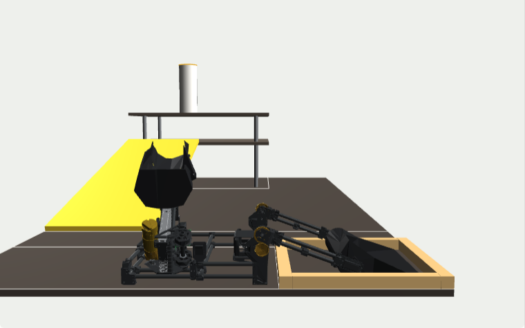
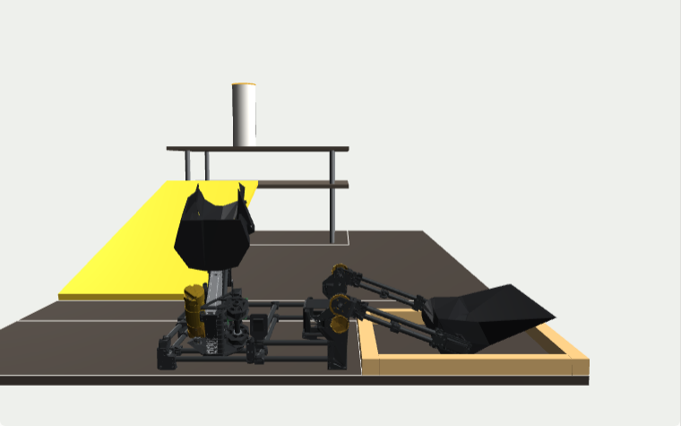
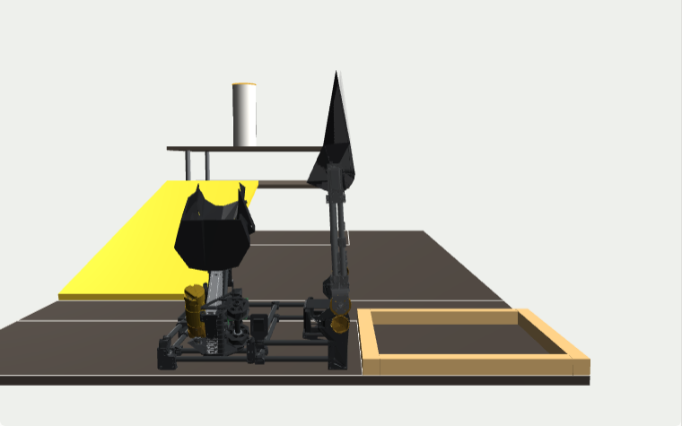
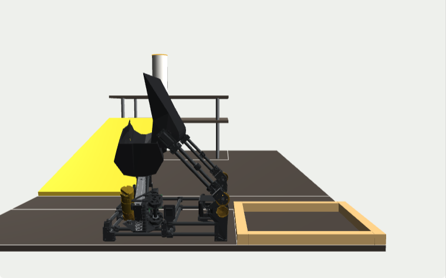
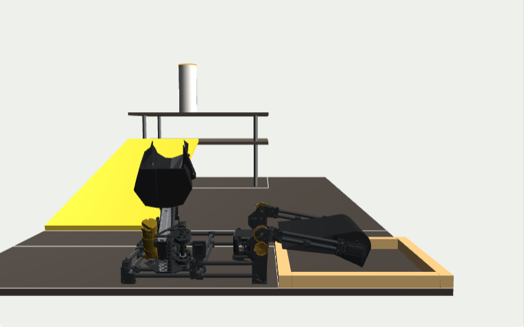
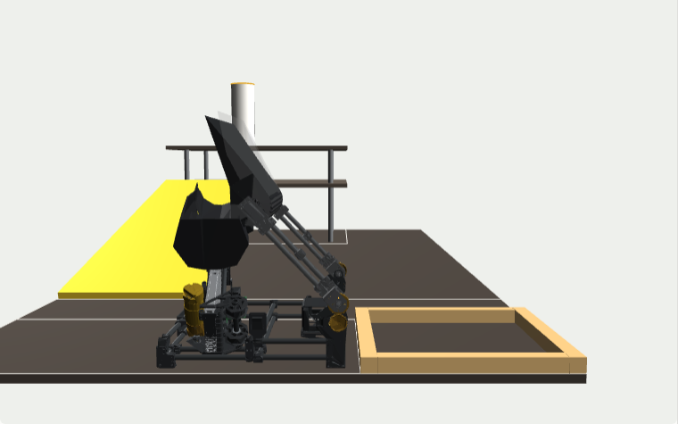
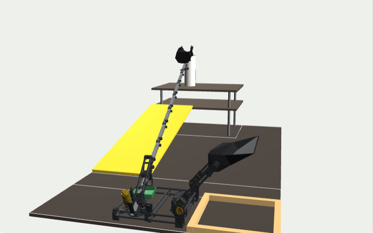
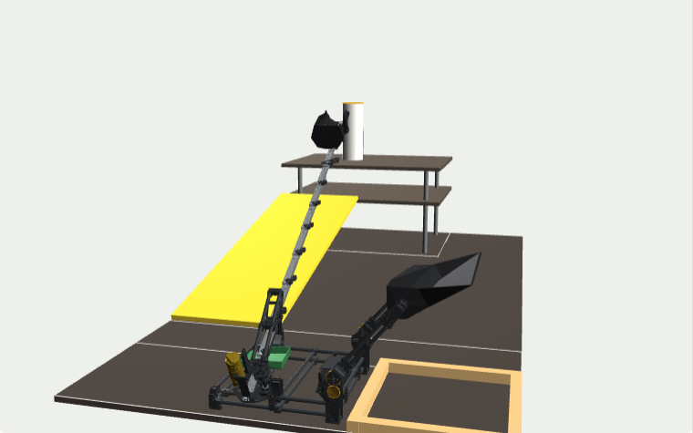

# Robot_Controller_V2_1

The competition program for the V2 robot (servo intake, goBILDA slide motor). It runs a **table of steps** from `Sequence.h`: V2's tested intake, V1's transfer (carry, pour, vibrate) and a profiled outtake that blends from fast into a slow creep so the bucket tips gently.

| File | What's in it | Who edits it |
|---|---|---|
| `Sequence.h` | **The state machine.** Named angles (degrees), slide positions (mm), speeds, and one row per step. | You, or `tools/sequence_editor.html` (saves straight to it) |
| `RobotConfig.h` | Pins, slide gear ratio and spool, servo calibration, slide gains, safety limits. Must match `ROBOT_SPECS.md`. | Calibration results, spec changes |
| `Robot_Controller_V2_1.ino` | The step runner, safety monitors, telemetry, serial console. No tuning numbers. | Code changes only |
| `SequenceTypes.h` | The keywords used in `Sequence.h` (`HOLD`, `WAIT_MS` ...). | Nobody |
| `MotionProfile`, `MotorController`, `ServoAxis`, `PIDController` | Trapezoid profiles (with blending), slide PID + feedforward, servo axes in degrees. | Code changes only |

## The sequence

| | Step | What happens | Ends when |
|---|---|---|---|
| Intake (V2) | `SCOOP_DOWN` | scoop jumps to `S_DOWN` | 500 ms |
| | `ARM_DOWN` | arm jumps to `A_DOWN` | 500 ms |
| | `SWEEP` | 2 s timed move: scoop `S_DOWN` → `S_SCOOP` while the arm goes `A_DOWN` → `A_PEAK` → `A_SCOOP` | done |
| | `PICKUP` | scoop to `S_PICKUP` (lip up) | 1000 ms (V1 used 100) |
| Transfer (V1) | `LIFT` | arm lifts to `A_TRANSFER` over 1 s, scoop still at pickup | 500 ms in |
| | `CARRY` | scoop to the carry angle `S_CARRY` while the arm keeps lifting | arm 90% up |
| | `POUR` | scoop tips to `S_POUR` over the bucket | done |
| | `VIBRATE` | scoop shakes ±`VIBRATE_DEG` at 10 Hz | 1000 ms |
| Outtake | `EXTEND` | arm to `A_MOVE` while the slides run at `SLIDE_FAST` to `X_CREEP` | reaches `X_CREEP` |
| | `CREEP` | slides carry on at `SLIDE_CREEP` (no stop in between) so the bucket tips slowly | reaches `X_TIP` |
| | `TIP_HOLD` | hold while the rocks fall | 300 ms |
| | `RETRACT` | slides back to 0 at `SLIDE_MAX` | arrived |

<table><tr>
<td> SWEEP</td>
<td> PICKUP</td>
<td> LIFT / CARRY</td>
<td> POUR</td>
</tr><tr>
<td> ARM_DOWN</td>
<td> VIBRATE</td>
<td> CREEP (CAD slide numbers)</td>
<td> RETRACT</td>
</tr></table>

Pictures come from the twin with CAD estimates; the twin's angles are only exact after the servo calibration.

**Rules for a row** (also in the comments of `Sequence.h`):
- ARM / SCOOP: an angle name, a number, or `HOLD`. `HOLD` means "don't touch it": a move started in an earlier step keeps going. That is how steps overlap (the arm keeps lifting through `CARRY`, the arm clears during `EXTEND`).
- MOVE: `INSTANT` (send the target, servo moves at its own speed, like V2), `PROFILED` (smooth, at `ARM_SPEED` / `SCOOP_SPEED`), or a time in ms (timed move; with `ARM VIA` the arm passes through that angle halfway).
- SLIDE: mm from fully in, or `HOLD`. Two slide rows in a row that keep going the same way **blend**: the first slows to the second's speed instead of stopping.
- NEXT WHEN: `WAIT_MS(ms)`, `WAIT_ARRIVED(ms)`, `WAIT_ARM(%)`, `WAIT_SLIDE(%)`.

## Editing and tuning

1. Open `tools/sequence_editor.html` in Chrome or Edge → **Open robot folder** → pick this folder. Edit, watch the twin and the predicted run time, **Save** (Ctrl+S).
2. Upload `Robot_Controller_V2_1.ino`.
3. First runs on the robot: set `SPEED_PCT_AT_BOOT = 25` (slow motion) and/or `STEP_MODE_AT_BOOT = true` (pauses after every step, `n` = next), or use the console commands below.
4. Log runs with `python tools/capture_log.py` and open the `.html` it writes.

**Tune it in the editor first**, then confirm on the robot: see [`SEQUENCE_TUNING.md`](../SEQUENCE_TUNING.md). The Jog sliders pose the twin with no robot; Capture writes the pose into an angle or slide position.

**Live link** (check poses by eye on the real robot): upload with `RUN_MODE = RUN_CONSOLE`, close the serial monitor, battery on, editor → Jog & live link → Connect. The same sliders now move the robot. Capture, Save, re-upload.

## Test settings (top of the .ino)

| Setting | Bench | Competition |
|---|---|---|
| `RUN_MODE` | `RUN_CONSOLE` for jogging / live link | **`RUN_FULL`** |
| `WAIT_FOR_GO` | `true` = wait for `g` after the USB reset | **`false`** |
| `FIRST_STEP` / `LAST_STEP` | run part of the sequence (e.g. 0..7 = intake + transfer only) | **0 / 255** |
| `STEP_MODE_AT_BOOT` | `true` = pause after each step | **`false`** |
| `SPEED_PCT_AT_BOOT` | 25 or 50 for first tries | **100** |

## Serial console (115200)

`x` stop · `g` run · `r <n>` run from step n · `t` step mode on/off · `n` next step · `k <pct>` speed % · `l` list steps · `p` config ·
`A <deg>` arm · `S <deg>` scoop · `Q` pose · `o <mm> [mm/s]` slide move · `j <pwm> <ms>` slide jog · `z` zero slide · `c` coast · `v` vibrate

Jog commands work in `RUN_CONSOLE`, or while `WAIT_FOR_GO` is waiting. During a run only `x`, `t` and `n` are accepted.

## Safety and events

- **Slide stall** (pushing ≥ 90 PWM, slower than 50 counts/s for 200 ms) or **timeout** (profile time + 1.5 s): runs the `RETRACT` step once, then stops. Events `STALL`, `TIMEOUT`, `FALLBACK`.
- **Wiring check**: driving one way but running away fast the other → motor off, `DIR_MISMATCH`.
- `SETTLED_SHORT`: the slide stopped close to (but not at) its target and the step moved on. Tune `SLIDE_KG` / `SLIDE_KS`.
- 60 s watchdog, I2C timeout recovery, `NO_SERVO_DRIVER` (won't run the slides with no servo board).
- DONE: motor off, servos hold, LED on.

## Changing the slide gear ratio

Edit `SLIDE_STEP_UP` in `RobotConfig.h` (and the spec in `ROBOT_SPECS.md`). Slide positions and speeds are in mm, so `Sequence.h` doesn't change. Gains are in motor encoder counts, so `KS`/`KV` stay valid; re-check `KG`/`KA` with `calibration/Slide_PID_Tune`. The editor shows the new free speed; keep `SLIDE_FAST`/`SLIDE_MAX` under about 80% of it.

## Telemetry

Same `D` columns as before so `tools/run_viewer.html` still works: arm logged as 0–1000 (650 = vertical, 5 per degree), scoop as µs-equivalent (2300 = 0°, 6.667 per degree), slides in encoder counts. `#STATES` carries the step names, `S` lines mark each step, `#CFG` lists calibration and gains.

Flash 28.0 KB of 30 KB, RAM 1.16 KB of 2 KB (no Adafruit servo library: a 30-line PCA9685 driver with the same 50 Hz setup).
