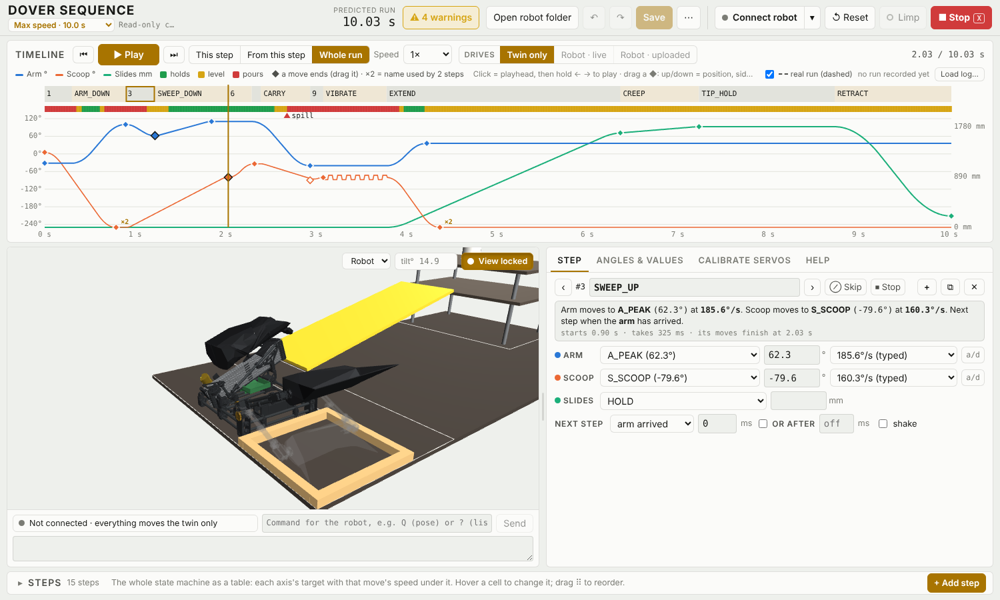
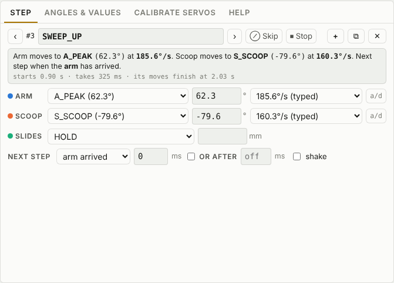
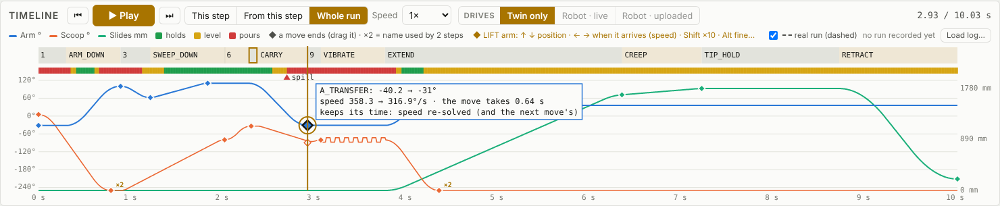
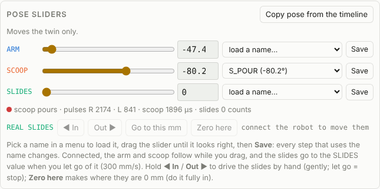

# Tuning the sequence digitally

Get the whole sequence right in the editor first. The robot is then only for confirming it. The tool is `tools/sequence_editor.html`: Chrome or Edge, with `three.min.js` and `twin_model.js` next to it. It reads and writes `Robot_Controller_V2_1/Sequence.h`, the same file the robot runs.

The page is laid out around the tuning loop: **pick a step, change it, watch it**.

| Where | What |
|---|---|
| Top bar | Folder, undo / redo, **Save**, **⋯** (copy / download), **Issues**, and the robot's **Connect ▾**, **↺ Reset**, **Limp**, **■ Stop**. The top bar never scrolls away. |
| Timeline (across the top) | The play controls, the step blocks, the scoop strip and the traces. Drag ◆ here. |
| Twin (left) | The 3D model, and under it the robot link: status, a command box and the robot's messages. |
| Side tabs (right) | **Step** (the selected step), **Angles & values** (pose sliders and every named number), **Calibrate servos**, **Help**. |
| **Steps** drawer (bottom) | The whole state machine as a table. Click **▸ Steps** to open it; drag its top edge to make it taller. |

Drag the bar between the twin and the tabs to give either more room (or focus it and use ← →). The page remembers the split, the drawer, and your play options.

## 0. How far you can trust the twin

| The twin is right about | The twin can't tell you |
|---|---|
| Order and overlap of steps, every motion profile (servos and slides), smooth take-overs, slide blending, predicted run time | Whether a loaded servo keeps up: a profile faster than about 430 °/s (358 °/s for the arm) finishes before the servo arrives (the editor flags those speeds) |
| Whether the scoop holds, is level or pours (the coloured strip) | Slide lag and stalls: the sim follows the profile perfectly, the real slides lag 0.1 to 0.2 s. Record a run on the robot to see it (§6). |
| Collisions you can see, once the angles are calibrated | Rocks |

- **Servo angles are only as good as the calibration.** Calibrated 16 Oct with the **Calibrate servos** tab (910 / 2105 / 1968 µs). Redo it if a servo horn is taken off or the twin and the robot disagree.
- **Slide tilt** (the **tilt°** box on the twin): 14.9° is a placeholder. Measure the real angle and type it in. It only changes the picture.
- **Slide positions** `X_CREEP` / `X_TIP` are 1670.2 / 1788.9 mm (tuned on the robot 15 Oct, re-scaled to 1:1 gearing 16 Oct). `X_TIP` is past the end stop (`SLIDE_END_STOP_MM`, ~1694 mm): CREEP stalls and the RETRACT fallback skips TIP_HOLD. **Issues** says so. Set it just before the stop with `calibration/Slide_Test`. The CAD says about 1650 / 1740.

## 1. Open the robot folder

Click **Open robot folder** and pick **`METR2800-GROUP1`** (the repo root: then runs are saved to `logs/` too). Picking `Robot_Controller_V2_1` also works for editing, but runs can't be saved. The button then shows the folder's name (✓); click it to switch folders. Until a folder is open you're on a read-only built-in copy and **Save** is greyed out. **Save** (Ctrl+S) writes `Sequence.h`, and `RobotConfig.h` too if you changed the calibration. "· unsaved" next to the file name means there are changes to save. Chrome remembers the folder: next time the button says **Reopen METR2800-GROUP1**.

**↶ ↷** (Ctrl+Z / Ctrl+Shift+Z) undo and redo any edit: table, Step tab, values, timeline drags.

## 2. Watch the sequence

One set of play controls, on the timeline:

| Control | What it does |
|---|---|
| **▶ Play** (Space, anywhere except a text box or a menu) | Plays what the **scope** says. Press again to pause; Play carries on from where you paused (or from where you clicked on the timeline, if that's inside the scope). |
| Scope: **This step** · **From this step** · **Whole run** | Only the selected step (for its own time, until the next step starts) · from the start of the selected step to the end · everything from the start. |
| **⏮** / **⏭** | Back to where the selected step starts (where the step before left things) / to where its moves finish. |
| **Speed** | 1× / 0.5× / 0.25× / 0.1×. Also sent to the robot, so its own runs go at the same speed. |
| **Drives** | What Play moves: **Twin only**, **Robot · live**, **Robot · uploaded** (§6). |

- **← →** select the previous / next step (from the selected one). The **‹ ›** in the Step tab do the same.
- **Click the timeline, then hold → / ←**: the playhead runs forwards / backwards at the **Speed** setting for as long as you hold the key (at 1× it plays the sequence normally; the twin shakes, and with Drives: **Robot · live** the robot follows). Let go and it stops there; ▶ Play carries on from there. While the timeline has the focus, **Shift+← →** select the previous / next step. A selected ◆ keeps the arrow keys (Esc gives them back).
- **Timeline**: step blocks on top (click one to select it). Under them is the scoop strip: **green** holds rocks, **yellow** level, **red** pours. Then the traces: arm (blue), scoop (orange), slides (green, right axis). Click or drag in the traces to move the playhead.
- The **grey ghost** in the twin is where the arm and scoop are heading (the target). The solid model is where they are now. While you edit or jog an angle, the ghost shows the old value instead (before / after). With the robot connected, the ghost is the **real robot**.
- **Click a step** (timeline, table or Issues) and the twin jumps to where that step **ends**.

3D view, same controls as Fusion 360 / Inventor. It starts **locked** (the **View locked** button on the twin) so a stray drag or scroll can't spin it; click the button to unlock:

| Do | Mouse | Trackpad |
|---|---|---|
| Zoom | scroll, zooms at the cursor | two-finger scroll or pinch |
| Pan | middle-drag | Shift + drag |
| Orbit | Shift + middle-drag, about the point under the cursor | drag |
| Fit the robot | double-click (middle or left) | double-tap |

Nothing is drawn over the view: the step, angles and scoop state are on the timeline and in the Step tab. Unlocked, **Reverse zoom** appears next to the lock (the controls are also in the lock button's tooltip). The **View** menu jumps to Robot / Side / Field (works while locked).

## 3. Change what a step does: the Step tab

Click a step's block on the timeline (or its row in the Steps table). The **Step** tab says in plain words what the step does, when it starts and how long it takes. Next to its name: **⊘ Skip** and **⏹ Stop** (test flags, below), **+** (add a step after it), **⧉** (duplicate) and **✕** (delete).

| Control | What it means |
|---|---|
| **Arm / Scoop** | A named angle, a number, or **HOLD**. HOLD doesn't stop the axis: a move started in an earlier step keeps going. That's how servos run asynchronously: start a move, then change step on a timer while it finishes. |
| **value box** | The number the target stands for. **↑ ↓** nudge it live (0.5°, Shift ×10, Alt ×0.2; 1 mm for slides). The twin jumps to the step's end pose, and a connected robot goes there too. One run of presses = one undo. |
| **×2** next to it | The name is used by 2 steps, so changing it changes both (the line underneath says which). **Change this step only** gives this step its own copy (`S_DOWN` → `S_DOWN_EXTEND`, same value), so your edits leave the other step alone. Rename the copy in Angles & values if you like. |
| **speed** (right of the value) | That move's speed: the default (`ARM_SPEED` / `SCOOP_SPEED`), `ARM_FAST` / `SCOOP_FAST` (the servo's own top speed, the old INSTANT), or a number. Every servo move is a smooth profile: it speeds up at the servo's accel (`ARM_ACCEL` / `SCOOP_ACCEL`) and slows down at its decel (`ARM_DECEL` / `SCOOP_DECEL`). A new target takes over a move that's still running without a jerk. |
| **a/d** (right of the speed) | Accel and decel of **this move only**, as a % of the axis's ACCEL / DECEL (100 = those, 1–255). Click it, type the %: it shows the resulting °/s² and how long the move now takes. Set, the button shows the numbers (e.g. **60/100%**); **Back to 100 %** resets it. The Steps table has the same two boxes under each servo cell. To change every move of a servo, change `ARM_ACCEL` / `ARM_DECEL` (or the SCOOP ones) in Angles & values instead. |
| **Slides / speed** | Target in mm, and a **named** speed (`SLIDE_FAST`, `SLIDE_CREEP`, `SLIDE_RETRACT_SPEED`; the retract speed brings `SLIDE_RETRACT_ACCEL` / `SLIDE_RETRACT_DECEL`, the others use `SLIDE_ACCEL` / `SLIDE_DECEL`). Slide speeds, accels and decels are fixed values you change in Angles & values, not per step. Two slide steps in a row, same direction, the first ending "when its moves finish" (or slides arrived): they **blend** with no stop (EXTEND → CREEP). With **all arrived**, the slides must be the last to get there, or they stop while the step waits for the arm / scoop. A step cut short with **− ms** hands its current speed on; the next move slows down to its own speed at the decel. |
| **Next step** | After N ms · when **all arrived** (± N ms): **every** axis has stopped, arm, scoop and slides, including moves started in earlier steps (SWEEP_DOWN waits for the scoop's SWEEP_UP move too) · when **one** axis has arrived (arm / scoop / slides, ± N ms; its move may have started in an earlier step) · when the arm / scoop / slides are N% of the way. **+ N ms** waits that long after arriving; **− N ms** moves on N ms *before* it arrives (by the plan), so the next move starts early and blends in. Example: SWEEP_UP on "arm arrived" ends the moment the arm reaches A_PEAK, so dragging that ◆ sideways moves the whole rest of the run with it. |
| **or after** | Off by default. Tick it to give the step a time limit (it starts at the step's time + 1 s; type your own): the step moves on after this long even if its condition never comes true (a stuck slide, a move that stalls). The robot logs `E,STEP_LIMIT,<step>`, and the timeline marks a step that ended on its limit with ⏱ and a red edge. |
| **Shake** | Vibrates the scoop ±N° at 10 Hz while the step runs. |

- **The table** (Steps drawer) has the same menus: each axis cell is the target with its speed under it. Cells read as plain text; hover a row to get the menus and the row buttons (↑ ↓ ⧉ ✕). **type a number…** for anything else (a servo speed above what the servo can do is allowed, but flagged). Faded cells are HOLD.
- **Add a step:** **+ Add step** (Steps drawer bar, also **+ Add step at the end** under the table, and **+** in the Step tab). Pick what it should do (move the arm, the scoop, both, the slides, shake, wait or empty); it goes after the selected step and opens in the Step tab.

- **Change a move on the timeline, like keyframes in a video editor:** every move a step starts has a **◆** where it ends (blue arm, orange scoop, green slides; hollow = cut short by a later step before it got there). Hover one to see which step and name it is. **Drag it up or down** to change the position. It stays where it is in time: the editor re-solves that move's speed so it still arrives when it did, and the next move on that servo too (its start just changed), so the other servos and the rest of the run don't move. When it can't (already at the servo's top speed, or still carrying a faster move in), the label says how much earlier / later it arrives. **×2** by a ◆ means its name is used by 2 steps: dragging it moves both (the other ◆ gets a dashed ring, and the label says so); use **Change this step only** in the Step tab first if you don't want that. **Drag it sideways** (servos) to change when it arrives: the editor works out the speed that makes it arrive there (from where and how fast the servo really is when the step starts). Nothing stops you at the servo's top speed (`ARM_FAST` / `SCOOP_FAST`): past it the label, the Steps table and Issues warn (⚠) that the real servo gets there later than the twin shows. When the accel / decel are what limit the move (more speed doesn't help), the label says so: raise them with **a/d**. Drag in any direction to do both at once. Slide ◆ only move up/down (their speeds are fixed). **Shift** = fine. **Click a ◆** to select it (ringed), then **↑ ↓** move the position (0.5° / 1 mm, Shift ×10, Alt ×0.2) and **← →** move when it arrives (10 ms steps); Esc deselects. The twin (and the real robot, with Drives: **Robot · live**) shows it while you drag. Esc cancels, Ctrl+Z undoes.
- **Change a step's time by dragging:** on the timeline, drag the right edge of its block; it changes how long that step takes. A label shows old → new and which number it changed (Esc cancels):
  - *after N ms* → N;
  - *when the moves finish* → the extra wait (to make the moves themselves quicker, drag their ◆ sideways);
  - *arm / slides N% of the way* → the %.
  If it won't go further, the label says why (for example a smooth move can't finish faster than `ARM_SPEED` allows).
- **Reorder:** drag ⠿ at the left of a row in the table.
- **Test only part of the run (test flags):** **⊘ Skip** (Step tab, the table's **Run** menu, or right-click the step on the timeline) takes a step out of the run: it stays in the file and on the timeline as a ⊘ chip, and the run goes straight past it (e.g. skip VIBRATE). **⏹ Stop** ends the run after that step: the robot goes back to the start pose (`A_START`, `S_START`, slides 0 mm, at jog speed), drawn as a **⏹ RESET** block; the steps after it stay on the timeline, greyed, with their normal timing (e.g. stop after PICKUP to test the intake). One stop at a time. Both are saved in `Sequence.h` (the FLAG column), so after Save + upload the real robot does the same. While any flag is set the timeline shows a red **TEST** chip (click it to go there) and Issues lists it: clear them before the competition.

### Programs (versions of the whole sequence)

The **Program** menu under the title picks which version of the whole sequence you're working on: **Max speed** (the tuned one), **Slow 20 s** and **Slow 30 s** (the same sequence with every speed slowed, accels by the square, and waits stretched, so the whole run takes 20 / 30 s; slower = more consistent). Each is its own file in `Robot_Controller_V2_1/programs/`; edit one and the others don't change. An unsaved program shows **•** in the menu. **Save** writes the changed programs and puts the selected one in `Sequence.h`, so **the robot runs the program that was selected when you saved and uploaded** (connected, ▶ Run warns if the robot has a different one). **＋ New program (scaled copy)…** makes a copy of the current one scaled to the run time you give; **Rename / delete…** is in the same menu.

## 4. Change a pose with the sliders (no robot needed)

The quickest way is the step's value boxes (§3: ↑ ↓). The **pose sliders** at the top of **Angles & values** are there for free posing:

1. In the menu next to a slider, pick the name to change (say `S_POUR`). The slider loads its value and the twin goes there. (**Show** next to a name further down does the same.)
2. Drag the slider until the twin looks right. The line under the sliders says whether the scoop holds or pours, and the pulse widths the servos will get. The grey ghost is the name's current value (before / after).
3. **Save** on that row. Every step that uses the name now uses the new value (**×2** next to a name says how many steps use it).
4. **Copy pose from the timeline** copies the pose at the playhead into the sliders.

With the robot connected (and ready), the arm and scoop follow the sliders while you drag. The **slides** go to the SLIDES value when you let go of its slider, type a number, or pick a name (300 mm/s, never past 5 mm short of `SLIDE_END_STOP_MM`; **Go to this mm** sends it again). The **REAL SLIDES** row also has:

- **◀ In** / **Out ▶**: hold to drive the slides gently (no position control, so it works before zeroing). Let go = stop. If they hit the end stop the robot cuts the motor and the editor stops too: press again to push further. X / ■ Stop also stop it.
- **Zero here**: where the slides are now becomes 0 mm (the robot only knows 0 as "where they were at power-on"). Drive them fully in with ◀ In first.
- The readout shows where the real slides are. While Drives: **Robot · live** follows with **Slides too**, the follow stream owns the slides, so these buttons are off.

Need a new pose? **Angles & values** → **Add** in that group. Click its name to rename it (every step that uses it follows), then pick it in a step. **✕** deletes a name no step uses (names the robot's code needs, like `A_START`, can't be deleted).

## 5. Checks before you upload

**Issues** in the top bar does most of this for you: **✓ No issues**, **⚠ n warnings** (yellow) or **✕ n errors** (red). Click it for the list; click an item to go straight to the step and the box to change (or to the number in Angles & values). It checks:

- names that don't exist and values that aren't numbers (errors);
- a run that never finishes (error: the robot's watchdog ends it at 60 s);
- servo speeds faster than the servo can go, servo targets outside their range;
- slide targets past the end stop, slide speeds above about 80% of the slides' free speed;
- **spill**: the scoop pours after it has picked up rocks but before the arm is back over the bucket (also marked on the scoop strip; it's a check on the twin's angles, so only as good as the calibration);
- steps that end straight away because they wait on something that isn't moving, steps never reached, two steps with the same name;
- steps that end on their **or after** limit in the twin (the condition never came true), and runs that never finish (it suggests adding a limit).

It can't see everything, so also check by eye:

- [ ] Scoop strip **green** from the end of SWEEP_DOWN until the arm is over the bucket, **red** at POUR.
- [ ] Nothing passes through anything in the twin: arm vs slides during EXTEND, scoop vs bucket at START and TRANSFER. Known issue: the CAD START pose overlaps the bucket a little until the servos are calibrated.
- [ ] Predicted run time (top bar) is well under the limit.

**Save**, then upload `Robot_Controller_V2_1.ino` in the Arduino IDE.

## 6. Try it on the robot

1. Upload `Robot_Controller_V2_1.ino` once (no settings to change), close the Arduino Serial Monitor and the Python logger, battery on.
2. **Connect robot** (top right). Connecting restarts the robot, and the editor tells it to hold still within 0.15 s (**▾** next to Connect switches to "run its uploaded sequence once", like at the competition). The badge under the twin says **Ready**, and the Connect dot turns green.
3. Always in the top bar:
   - **■ Stop** (or the **X** key, anywhere except while typing in a text box): stops playback, the robot's run, the slides (they go loose) and the shaking. Robot · live drops back to Twin only.
   - **↺ Reset**: slides to 0 mm at 300 mm/s and the timeline to 0 s. With the slides out, the arm and scoop first go to `A_RESET` / `S_RESET` (clear of the slides; tune them in Angles & values) and only go to `A_START` / `S_START` (the IDLE pose) once the robot reports the slides in. If they don't get in within 12 s, the servos stay put and it says so. Slides already in: straight to the start pose. ⏹ Stop (test flag) resets the same way. **Drives** goes back to what you last picked: after ■ Stop or Limp dropped Robot · live to Twin only, Reset turns following back on (the robot moves to the start pose smoothly first, no jump).
   - **Limp**: all three servos and the slides go loose so you can move them by hand. The button stays red while limp; click it again to power the servos at the pose the twin shows.
4. Pick what Play moves with **Drives** (on the timeline):
   - **Robot · live** (no upload needed): the real robot copies the twin while you scrub, play, drag a ◆ or nudge a value. **Slides too** off = arm and scoop only. Before playing, the robot moves to where the scope starts with smooth jog moves (no jump) and the button says **Lining up…**. This runs what's **on screen**, so you can edit, play, edit again with no upload. It's the editor's timing, not the robot's: a stall or a slow servo won't hold the timeline up, and the slides follow the planned path rather than running their own profile.
   - **Robot · uploaded** (what the robot does at the competition): **▶ Run** lines the robot up where the scope starts, then runs the copy in its memory from that step (`r <step>`, found by name in the robot's own list). **This step** runs just that one step. **Pause each step** makes the robot stop after every step; **Continue ▸** runs the next. While it runs, the twin shows the real robot, the playhead follows it, and the button is **■ Stop run**. If the robot's uploaded steps differ from the editor's (unsaved or not uploaded), ▶ Run says so. It won't run while the robot is limp: click **Limp** to power it first.
5. **Every run is recorded.** Each live play and each uploaded run (also one the robot does on its own, e.g. with "run once" on connect) is saved to `logs/run_<date>_<time>_editor_….csv`, the same format as `tools/capture_log.py`, so `tools/run_viewer.html` opens it. The last run is drawn **dashed** over the timeline, so you can see where the real robot lags or stops short of the prediction. **real run (dashed)** hides it, **Load log…** draws any older log (from the editor or the Python logger), **Download** saves the last one when no folder is open.
6. When it's right: **Save**, upload, and check one full run: Drives **Robot · uploaded**, **Whole run**, **▶ Run**. Competition: nothing to change. With no computer attached, the robot waits 0.15 s and runs.

Not working? The badge and the red box under it say why (for example an older program on the robot: upload the latest V2.1 once).

## 7. Keeping the code and the editor in step

`Sequence.h` is the only copy of the sequence. **Whichever was edited last wins** (AGENTS.md rule 7):

- Edited `Sequence.h` by hand or with an agent? Opening the folder in the editor reads it as it is. Ask the agent to refresh the editor's built-in snapshot too (that is only what the page shows before a folder is opened).
- Used the editor without the folder (a browser with no folder access)? **⋯** → **Download** or **Copy**, replace `Sequence.h` with it, and tell your agent.
- Keep the file's format if you edit by hand: `const float NAME = value;  // note` lines under the `// ---- … ----` headers, one `{ "STEP", … },` row per step. **Issues** shows an error if it can't read something.
