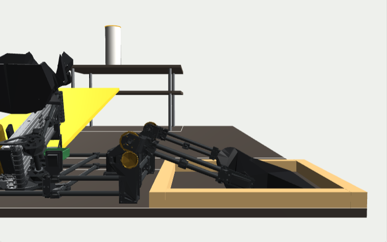
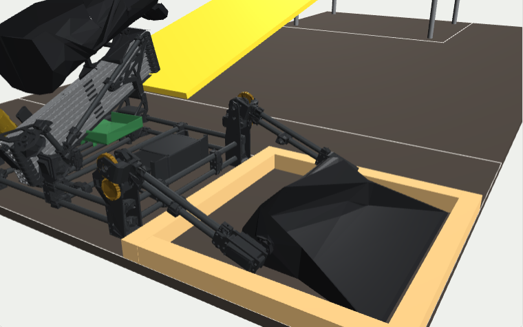
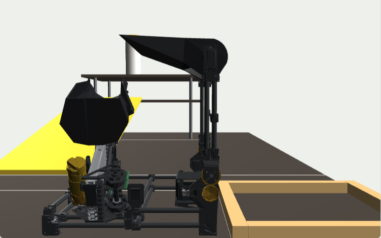

# Calibrating DOVER

Do these in order the first time, and again after a rebuild. Battery **on** for every step (the encoder's 5 V comes from the battery side). Serial Monitor at **115200**, line ending **Newline**.

To save a test as graphs instead (Slide_Test, Slide_PID_Tune), use the Python logger. First-time setup: [`Robot_Controller_V2_1/LOGGING.md`](../Robot_Controller_V2_1/LOGGING.md).

| # | Sketch / tool | What you find | Where it goes |
|---|---|---|---|
| 1 | `Slide_Encoder_Check` | wiring, encoder and motor direction | `SLIDE_ENCODER_DIR`, `SLIDE_MOTOR_DIR` in `RobotConfig.h` |
| 2 | `Slide_Test` | static friction and gravity (`ks`, `kg`), where the bucket touches the pole and where it has fully tipped (mm) | gains → `RobotConfig.h`; positions → `X_CREEP`, `X_TIP` in `Sequence.h` |
| 3 | `Slide_PID_Tune` | slide gains | `SLIDE_K*` in `RobotConfig.h` (`g` prints them) |
| 4 | editor → **Calibrate servos** (or `Servo_Offset_Cal`) | the 3 servo pulse widths at the reference pose (+ optional scale check) | editor → **Apply** → Save (or `*_CAL_US` in `RobotConfig.h`) |
| 5 | `tools/sequence_editor.html` | poses in the twin, then by eye on the real robot (Connect robot, Step & move tab) | `Sequence.h` |

`_old/Motor_Pin_Test` is the retired pin finder from the old DIR+PWM driver. Don't use it.

---

## 1. Encoder and motor direction: `Slide_Encoder_Check`

Upload, then push the slides out by hand. The raw count goes **negative** when extending (expected, tested 14 Oct). Type `+`: the slides must go **out**. If they go in, flip `SLIDE_MOTOR_DIR` in `RobotConfig.h` (still unconfirmed). If the count drifts while nothing moves, check the battery first.

## 2. Slide numbers: `Slide_Test`

See `Slide_Test/README.md` for jogging and finding `ks` / `kg`. Then find the two outtake positions (zero with the slides fully in first):

1. `m 1000` then small steps (`mr 20`) until the bucket lip **just touches the pole**. Note the mm.
2. `X_CREEP` = that number minus about 30 mm (the slides slow to the creep speed here).
3. Keep stepping until the bucket has **fully tipped** and the rocks are out. That is `X_TIP`.
4. Put both in the editor (Angles & values → Slide positions) and Save. The current values are 1666.7 / 1788.9 mm (tuned 15 Oct, re-scaled 16 Oct). `X_TIP` is past the end stop (~1694 mm), so set it just before the stop. The CAD estimate is about 1650 / 1740 mm.

## 3. Gains: `Slide_PID_Tune`

See its README. Paste the `g` output into the `SLIDE_K*` lines of `RobotConfig.h` (same numbers, new names: `OUTTAKE_KP` → `SLIDE_KP` and so on).

## 4. Servo offsets: editor or `Servo_Offset_Cal`

**Easiest: the sequence editor.** With `Robot_Controller_V2_1` uploaded: editor → **Connect robot** (top right, with "hold still and wait" picked under the twin), then the **Calibrate servos** tab. It walks through the same steps as below with buttons (limp, power, −5 / −1 / +1 / +5 µs) and shows what **Apply** will change before you press it.

**Without the editor:** the `Servo_Offset_Cal` sketch and the Serial Monitor, as below. Full command list, scale check and troubleshooting: [`Servo_Offset_Cal/README.md`](Servo_Offset_Cal/README.md).

The servos have no position feedback, so the code only knows angles through these three numbers. The V2 pulse widths are already right on the robot; this step makes the **twin** match the robot, so the angles you edit mean real degrees.

**Reference pose = scoop laid flat on the intake floor.** It's a hard stop: the floor fixes the scoop's angle, and the scoop resting on the floor fixes the arm's angle. One pose sets all three servos. The CAD puts it at arm **110.6°**, scoop **−69.4°**.

<table><tr>
<td></td>
<td></td>
</tr><tr><td colspan="2">Reference pose: the whole blade sits on the floor, the curled back of the scoop points up.</td></tr></table>

Setup: robot on a flat surface at intake-floor height, slides fully in, battery on. Have a strip of paper ready.

1. Upload `Servo_Offset_Cal`. The servos start **limp**. Lower the scoop to the floor by hand so the servos don't jump far.
2. Type `cal`. All three servos drive to the reference pose using the current numbers.
3. **Arm limp, set the scoop.** Type `off r` and `off l`. The arm settles until the scoop rests on the floor under its own weight (if the servo gears hold it up, press the arm down lightly). Use `s+` / `s-` (5 µs steps, `step 2` for finer) until the blade lies **flat**: a strip of paper is trapped under the lip **and** under the back edge of the blade.
4. **Right arm servo.** `on r`. If the arm lifts or presses down, adjust `r+` / `r-` until switching `on r` / `off r` doesn't move the arm and the paper stays trapped at both edges. Then `off r`.
5. **Left arm servo.** `on l`, same as step 4 with `l+` / `l-`.
6. `on all`. The arm should hold quietly. If it hums, the two arm servos disagree: nudge `l` by ±5 µs until it stops.
7. `p` prints three lines.

Then open the sequence editor → **Calibrate servos** tab → type the three numbers → **How the robot moves** → **Apply to the editor** → **Save**. This rewrites the angles in `Sequence.h` so the robot makes exactly the V2 moves it makes today, and the twin now shows them correctly. (No editor? Paste the three lines into `RobotConfig.h` and ask your agent to re-work the angles in `Sequence.h` so the pulse widths stay the same.)

### Optional scale check (2 minutes)

Checks that the servos really are 300° (8.0 µs per arm degree, 6.667 per scoop degree). After step 7, type `level`. The arm should stand vertical and the scoop blade should be level on top:

Put a phone level on an arm post and use `a+` / `a-` (both arm servos together) until it reads 90°. Put it on the blade and use `s+` / `s-` until level. `p`, then enter the right-arm and scoop numbers under **Scale check** in the editor. If either is more than about 3% off, tell your agent: the scale in `RobotConfig.h` needs changing.

## 5. Poses: twin first, then on the robot

Set poses in the twin first (no robot needed): see [`SEQUENCE_TUNING.md`](../SEQUENCE_TUNING.md). Then upload `Robot_Controller_V2_1` (no settings to change), close the serial monitor, open the editor → **Connect robot** (top right). Select a step and nudge its value boxes with ↑ ↓ (Step & move tab), or use the Pose sliders tab: the real arm and scoop follow. Then Save the file and re-upload. **Move robot** next to an angle (Angles & values) moves the robot to it; while connected the grey ghost in the twin is the real robot.

---

## Changing the slide gear ratio

1. Change `SLIDE_STEP_UP` in `Robot_Controller_V2_1/RobotConfig.h` and the step-up row in `ROBOT_SPECS.md` (or just tell any agent "slide step-up is now X:1").
2. Nothing in `Sequence.h` changes: positions and speeds are in mm. Exception: values tuned on the robot while the code had the wrong ratio must be scaled by old ÷ new mm/count (16 Oct: everything ÷ 1.8).
3. Run `Slide_Encoder_Check` `c 300` to confirm mm per count.
4. Gains are in motor encoder counts, so `KS` / `KV` carry over. Re-check `KG` / `KA` with `Slide_PID_Tune` (the load the motor feels changes).
5. The editor shows the new free speed under Angles & values. Keep `SLIDE_FAST` and `SLIDE_RETRACT_SPEED` under about 80% of it.

The calibration sketches keep their own copies of the slide numbers. If you change the ratio, update `MM_PER_TICK` / `MM_PER_COUNT` at the top of `Slide_Encoder_Check`, `Slide_Test` and `Slide_PID_Tune` as well.
